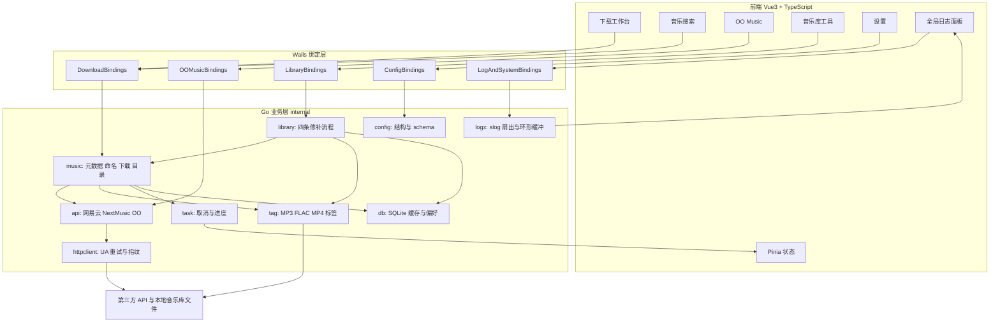

## 产品概述
将现有 Python 音乐下载与整理工具完整重写为桌面图形应用，覆盖在线下载、自动整理、存量音乐库修补全流程。主界面采用工作台布局：左侧导航、顶部状态区、底部常驻可展开的全局日志窗口。配置以 YAML 文件保存，并提供可视化配置修改界面。

## 核心功能
- 网易云单曲、专辑、歌单下载：支持 ID 或分享链接、7 档音质、指定曲目编号（数字、逗号、区间混排）、已存在文件跳过、实时进度与结果汇总、上次偏好自动回填。
- 音乐搜索与 OO Music 下载：关键词搜索、结果列表、歌曲详情、可用音质列表、单曲下载与批量下载全部结果，任务可随时取消。
- 自动整理与元数据：按专辑或歌单生成目录、说明文件、封面与歌词文件；写入标题、艺术家、专辑、曲目号、歌词、封面与来源 ID 标签；统一文件命名与非法字符清洗。
- 存量音乐库工具：选择目录后批量执行歌词修复、封面重下、艺术家拆分、元数据补全，显示逐目录进度，跳过已处理项且出错不中断。
- 备用解析通道：可切换的备用歌曲地址解析与缓存，失败自动重试并回退。
- 可视化配置：全部配置项分组表单、字段级校验、保存、重新加载、恢复默认、目录选择、修改后即时生效。
- 全局日志窗口：常驻实时日志流、等级过滤、关键字搜索、清空、自动滚动、导出与打开日志目录。
- 任务控制：下载与修补进度、取消当前任务、打开下载目录。

## 视觉效果
深色现代桌面工作台风格，玻璃质感面板与青紫渐变强调色，卡片与表格层次清晰；导航切换、按钮、进度条与日志新行带平滑微动效；窗口缩放时侧栏可折叠，日志面板高度可拖拽并可全屏展开。


## 技术栈选型
- 桌面框架：Wails v2 稳定版（Windows WebView2）。保留现有 `go.mod` 的 `module go-music-tools`，补齐 `main.go`、`app.go`、`wails.json` 与 `frontend/` 标准骨架，不改动源 Python 项目。
- 前端：Vue 3 + TypeScript + Vite + vue-router + Pinia；组件库 TDesign Vue Next；主题用 CSS 变量与少量原生 CSS 动画，避免重型样式框架。
- 后端：Go 1.22 及以上，标准库 `log/slog`；`gopkg.in/yaml.v3` 读写配置；`modernc.org/sqlite`（纯 Go、免 CGO，Windows 构建友好）作缓存；`gopkg.in/natefinch/lumberjack.v2` 做日志文件轮转。
- 音频标签：`internal/tag` 定义统一读写接口，按格式选用成熟纯 Go 库（MP3 ID3v2、FLAC Vorbis 与 Picture、MP4 原子盒）。实现前先做一次写入验证 spike，确认 `©nam/©ART/©lyr/trkn/covr/freeform` 与 `CMUSIC_ID` 可写；若某格式库能力不足，按格式降级并输出可操作日志，不引入 ffmpeg 运行时依赖。
- TLS 指纹：NextMusic V2 对标 Python 的 `curl_cffi impersonate="chrome120"`，用基于 uTLS 的 Go 指纹客户端（如 `bogdanfinn/tls-client`）作为可选通道；标准 `net/http` 优先，失败后按配置降级，避免全局强依赖。

## 实现策略
采用分层加端口适配器：所有网络、下载、标签、修补逻辑放在纯 Go `internal/` 包中，Wails 绑定层只做 DTO 转换与事件转发，前端只通过绑定方法与事件通信，不接触文件路径与网络细节。这样业务包可独立单元测试，且未来更换桌面框架不需重写业务。

关键决策与取舍：
1. **配置单点定义**：`Config` 结构体同时承载 YAML 标签、默认值与校验；`schema.go` 导出字段元数据（分组、类型、枚举、范围、说明），通过 `GetConfigSchema` 绑定返回给前端动态渲染表单，避免前后端重复定义与字段漂移。保存流程为「校验 → 写临时文件 → 原子 rename → 重新加载 → 广播变更事件」，保证不会出现半配置文件。
2. **日志扇出**：自定义 `slog.Handler` 一次写入三处——轮转文件、内存环形缓冲（约 2000 条）、Wails 事件（50 毫秒或 100 条批量聚合）。前端挂载后先拉历史日志回放，消除启动早期日志丢失；批量推送避免高频日志压垮 WebView2 与前端重渲染。
3. **任务模型**：每个下载或修补任务持有独立 `context.Context`，`TaskManager` 保证同一时刻仅一个主任务（可配置有界并发），取消信号贯穿 HTTP 请求、流式写入与曲目循环；进度通过 `task:progress` 事件推送。替代原 Python 的 ESC 逐字符监听。
4. **对齐而非照抄缺陷**：源项目已确认的死配置（`filename.pattern`、`network.api_delay_min`、`logging.*`）、零业务引用的 V1 AES-GCM 与 Album 工具不迁移；同时修正 `music_url` 只写内存、OO Music 选低音质时扩展名错配、日志无轮转等缺陷。

## 性能与可靠性
- 批量任务为 O(n) 曲目循环，瓶颈是第三方 API 限流与网络 I/O 而非 CPU。缓解手段：全局元数据请求限流（沿用跨进程时间戳语义并落 SQLite）、429 与 payload 内 429 的指数退避、元数据与 NextMusic 结果缓存，避免 N+1 式重复请求；专辑与歌单一次请求取回曲目表，再逐曲按需取详情。
- 音频下载用 `io.Copy` 流式写入 `.part` 临时文件后原子 rename，不整文件驻留内存、不留半文件；封面字节一次下载后复用于落盘与标签嵌入；标签写入按「探测格式 → 一次性打开 → 写入 → 保存」执行，避免多次重写。
- 日志前端用虚拟列表，仅渲染可视行；配置热更新不重启应用。
- 安全与可靠性：不记录完整下载 URL、响应体与凭据；`InsecureSkipVerify` 仅用于第三方代理且提供配置开关与风险提示；路径清洗防止目录穿越，Windows 长文件名按 120/80/60/40 逐级收缩；SQLite 启用 WAL 与 busy timeout；文件覆盖前检查存在性并支持跳过。

## 实现备注（执行要点）
- 源项目只读参考，不修改；目标工作区目前仅 `go.mod`，无向后兼容负担，但功能语义须逐条对齐，尤其是 4 条修补流程的 `CMUSIC_ID` 幂等判据、专辑与歌单目录结构、7 档音质与曲目编号解析。
- 沿用源项目「所有行为由配置驱动，勿硬编码」约定；API 契约以 `docs/api/get_song.md`、`get_album.md`、`get_playlist.md` 与源码为准，README 中关于 V2 加密与日志轮转的描述不采信。
- 后端包不得直接 import Wails runtime（日志与事件通过接口注入），保证 `go test ./...` 可运行；绑定方法集中注册，避免散落。
- 影响范围控制：新增配置文件名统一为 `config.yaml`，不读写原 `config.yml`；数据库为新建 `app.db`，不迁移旧 `cloud-music.db`；NextMusic V1 加密文档仅作参考保留在迁移说明中。

## 架构设计


## 目录结构
整体为「Go 业务层 + Wails 绑定层 + Vue 前端层」三层，文件均落地于 `d:/Workspaces/JetBrains/Goland/go-music-tools/`。

```
go-music-tools/
├── go.mod                                  # [MODIFY] 保留 module 名，补齐 Go 版本与全部依赖
├── go.sum                                  # [NEW] 依赖校验和
├── wails.json                              # [NEW] Wails 项目配置：前端构建命令、产物名、窗口尺寸、Windows 资源
├── main.go                                 # [NEW] Wails 入口：初始化配置/日志/DB，注册绑定，创建窗口
├── app.go                                  # [NEW] App 生命周期钩子：startup 注入运行时事件发射器、shutdown 关闭资源
├── config.yaml                             # [NEW] 新版 YAML 默认配置；首次启动自动生成，界面可编辑
├── .gitignore                              # [NEW] 忽略 build/bin、frontend/dist、app.db、logs、downloads
├── README.md                               # [NEW] 运行/构建说明、配置字段说明、与 Python 版功能映射
├── docs/
│   └── migration-notes.md                  # [NEW] 源模块到 Go 包映射表、API 字段契约、已知差异与不迁移项
├── internal/
│   ├── config/
│   │   ├── config.go                       # [NEW] Config 结构：api/download/filename/metadata/network/logging/advanced 分组与校验
│   │   ├── store.go                        # [NEW] Load/Save/Reload/Reset：默认值合并、临时文件原子写、并发读写锁
│   │   ├── schema.go                       # [NEW] 字段元数据（类型/枚举/范围/分组/说明）供前端动态表单渲染
│   │   └── config_test.go                  # [NEW] 默认值、校验、原子写与重载单测
│   ├── logx/
│   │   ├── logger.go                       # [NEW] slog 初始化：级别、格式、文件轮转、多 Handler 扇出
│   │   ├── wails_handler.go                # [NEW] Wails 事件 Handler：批量节流、结构化字段序列化、事件名常量
│   │   ├── ring.go                         # [NEW] 固定容量环形缓冲，供前端挂载后回放历史日志
│   │   └── entry.go                        # [NEW] LogEntry DTO：时间、级别、来源、消息、字段
│   ├── db/
│   │   ├── db.go                           # [NEW] SQLite 初始化：WAL、busy_timeout、单连接复用
│   │   ├── migrations.go                   # [NEW] 建表 DDL：preferences、music_info、music_url、task_history
│   │   ├── repo_prefs.go                   # [NEW] 上次下载偏好与元数据限流时间戳读写
│   │   └── repo_cache.go                   # [NEW] 歌曲信息与播放地址缓存（真正落库，修复源项目内存缓存缺陷）
│   ├── model/
│   │   └── model.go                        # [NEW] SongMeta/AlbumMeta/PlaylistMeta/QualityOption/TaskProgress/ResultSummary DTO
│   ├── httpclient/
│   │   ├── client.go                       # [NEW] 统一 HTTP 客户端：Chrome UA、origin/referer、超时、TLS 开关
│   │   ├── retry.go                        # [NEW] 429 与 payload 429 检测、指数退避、随机延迟、context 取消
│   │   └── tlsclient.go                    # [NEW] Chrome TLS 指纹客户端适配，仅 NextMusic V2 降级时使用
│   ├── api/
│   │   ├── netease.go                      # [NEW] /Song_V1、/Album、/Playlist、/Search 请求与响应解析、ID 提取
│   │   ├── nextmusic.go                    # [NEW] V2 getSongInfo/getSongLyric/getSongUrl 三接口与缓存拼装
│   │   └── oomusic.go                      # [NEW] OO Music 搜索、详情、音质列表、封面与歌词地址解析
│   ├── music/
│   │   ├── metadata.go                     # [NEW] 元数据聚合：限流、重试、音质校验、NextMusic 开关分流
│   │   ├── filename.go                     # [NEW] 非法字符清洗、命名模板、扩展名推断、Windows 长名收缩
│   │   ├── indexes.go                      # [NEW] 曲目编号解析：空格/逗号/中文逗号/区间，排序去重
│   │   ├── indexes_test.go                 # [NEW] 编号解析边界单测
│   │   ├── filename_test.go                # [NEW] 命名与清洗单测
│   │   ├── downloader.go                   # [NEW] 流式下载、重试、已存在跳过、进度上报、取消
│   │   └── organize.go                     # [NEW] 专辑/歌单目录、说明文件、ID 文件、封面下载、曲目循环调度
│   ├── tag/
│   │   ├── tag.go                          # [NEW] 统一 TagHandler 接口、格式判定、支持的扩展名集合
│   │   ├── mp3.go                          # [NEW] ID3v2 读写：TIT2/TPE1/TALB/TYER/TRCK/COMM/APIC/TXXX
│   │   ├── flac.go                         # [NEW] Vorbis 注释与 Picture 读写
│   │   ├── mp4.go                          # [NEW] MP4 原子读写：©nam/©ART/©alb/©lyr/trkn/covr/freeform
│   │   ├── cmusic.go                       # [NEW] CMUSIC_ID 读写与旧键兼容，供修补流程幂等判据
│   │   ├── picture.go                      # [NEW] 封面 MIME 判定、尺寸解析与嵌入复用
│   │   └── tag_test.go                     # [NEW] 各格式写入与回读验证 spike 的固化测试
│   ├── library/
│   │   ├── albuminfo.go                    # [NEW] album_info.txt 解析、音频文件枚举与匹配
│   │   ├── folders.go                      # [NEW] 目录遍历、批量调度、逐目录进度与错误不中断
│   │   ├── fix_lyrics.go                   # [NEW] 歌词修复：幂等判据、完整歌词、MP3 分块、lrc 归档
│   │   ├── fix_cover.go                    # [NEW] 封面重下：分辨率阈值、备份与覆盖
│   │   ├── fix_artists.go                  # [NEW] 艺术家拆分与按 index_format 重建文件名
│   │   └── fix_metadata.go                 # [NEW] 缺失元数据补全、年份推导、封面替换
│   ├── oomusic/
│   │   ├── service.go                      # [NEW] 搜索缓存、详情、音质降级选择、单曲与批量下载、中断
│   │   └── tags.go                         # [NEW] OO Music 专用标签（GENRE/DATE/LANGUAGE 等）
│   ├── task/
│   │   ├── manager.go                      # [NEW] 任务注册、互斥执行、context 取消、结果汇总
│   │   └── events.go                       # [NEW] 事件名常量与载荷：log:batch、task:progress、task:done、config:changed
│   └── bindings/
│       ├── dto.go                          # [NEW] 绑定层请求与响应 DTO，隔离内部结构
│       ├── download.go                     # [NEW] DownloadSong/Album/Playlist、Search、ParseIndexes、CancelTask
│       ├── oomusic.go                      # [NEW] OOSearch/OODetail/OOQualities/OODownload/OOBatchDownload
│       ├── library.go                      # [NEW] SelectDirectory、RunLibraryFix 与四种工具入口
│       ├── config.go                       # [NEW] GetConfigSchema/GetConfig/SaveConfig/ReloadConfig/ResetConfig
│       ├── logs.go                         # [NEW] GetRecentLogs/ClearLogs/ExportLogs/OpenLogDir
│       └── system.go                       # [NEW] OpenDownloadDir、GetAppInfo、GetTaskStatus
└── frontend/
    ├── package.json                        # [NEW] Vue3/TS/Vite/vue-router/Pinia/tdesign-vue-next 依赖与脚本
    ├── vite.config.ts                      # [NEW] Vite 配置与 Wails 开发服务器端口对齐
    ├── tsconfig.json                       # [NEW] TypeScript 严格模式与路径别名
    ├── index.html                          # [NEW] 挂载点与字体、主题变量预置
    ├── wailsjs/                            # [NEW] Wails 自动生成的绑定声明与运行时（生成物，勿手改）
    └── src/
        ├── main.ts                         # [NEW] 应用入口、Pinia、router、TDesign 注册
        ├── App.vue                         # [NEW] 根布局：侧栏、顶部栏、内容区、常驻全局日志面板、状态条
        ├── env.d.ts                        # [NEW] Vue SFC 与 Wails 类型声明
        ├── router/index.ts                 # [NEW] 五个页面的路由与默认重定向
        ├── types/index.ts                  # [NEW] 与 Go DTO 对齐的 TS 类型与枚举
        ├── api/bindings.ts                 # [NEW] 绑定方法统一封装与错误归一化
        ├── api/events.ts                   # [NEW] EventsOn/Off 封装、订阅生命周期与去重
        ├── stores/config.ts                # [NEW] 配置 schema、当前值、脏状态与保存动作
        ├── stores/logs.ts                  # [NEW] 日志环形列表、等级过滤、关键字、自动滚动、未读错误计数
        ├── stores/task.ts                  # [NEW] 当前任务、进度、取消状态与结果汇总
        ├── components/layout/AppSidebar.vue        # [NEW] 左侧导航与折叠、选中态微动效
        ├── components/layout/AppTopBar.vue         # [NEW] 顶部标题、当前任务状态、快捷操作
        ├── components/layout/AppStatusBar.vue      # [NEW] 底部状态条：错误计数、配置路径、版本
        ├── components/log/GlobalLogPanel.vue       # [NEW] 常驻可折叠可拖拽全屏的日志窗口、虚拟列表
        ├── components/log/LogToolbar.vue           # [NEW] 等级过滤、搜索、清空、导出、打开目录、自动滚动
        ├── components/log/LogRow.vue              # [NEW] 单行日志：时间、等级色标、来源、消息、淡入
        ├── components/config/ConfigForm.vue       # [NEW] 按 schema 分组渲染、脏值追踪、批量保存
        ├── components/config/ConfigField.vue      # [NEW] 开关/数字/下拉/路径字段通用渲染与字段级校验
        ├── components/config/ConfigSection.vue    # [NEW] 分组卡片与说明、变更差异对比
        ├── components/common/QualitySelect.vue    # [NEW] 7 档音质下拉（含说明与默认值）
        ├── components/common/IndexPicker.vue      # [NEW] 曲目编号输入、解析预览与数量确认
        ├── components/common/TaskProgressCard.vue # [NEW] 进度条、逐曲状态、取消按钮、结果统计
        ├── components/common/FolderPicker.vue     # [NEW] 目录选择与路径回显
        ├── components/common/StatCard.vue         # [NEW] 成功/跳过/失败指标卡
        ├── views/DownloadView.vue          # [NEW] 下载工作台：方式卡片、参数表单、任务区、最近记录
        ├── views/SearchView.vue            # [NEW] 网易云搜索：搜索栏、结果表、详情抽屉、批量入队
        ├── views/OOMusicView.vue           # [NEW] OO Music：搜索、音质对比、单曲与批量下载控制台
        ├── views/LibraryToolsView.vue      # [NEW] 目录选择、四个工具卡片、执行参数、逐目录进度
        ├── views/SettingsView.vue          # [NEW] 分组侧栏、动态表单、操作条、生效状态预览
        ├── styles/theme.css                # [NEW] 颜色、字体、圆角、阴影、渐变 CSS 变量
        └── styles/global.css               # [NEW] 全局排版、滚动条、过渡与微动效
```

## 关键代码结构
```go
// internal/config/config.go：配置的唯一真实来源，前端表单由此生成
type Config struct {
    API       APIConfig       `yaml:"api"`
    Download  DownloadConfig  `yaml:"download"`
    Filename  FilenameConfig  `yaml:"filename"`
    Metadata  MetadataConfig  `yaml:"metadata"`
    Network   NetworkConfig   `yaml:"network"`
    Logging   LoggingConfig   `yaml:"logging"`
    Advanced  AdvancedConfig  `yaml:"advanced"`
}

func DefaultConfig() Config
func (c *Config) Validate() map[string]string // 返回字段路径到错误说明
```

```go
// internal/tag/tag.go：所有下载与修补流程依赖的标签抽象
type TagHandler interface {
    Read(path string) (TrackTags, error)
    Write(path string, tags TrackTags) error
    Supports(ext string) bool
}

type TrackTags struct {
    Title, Album, Lyrics, CMusicID string
    Artists                        []string
    TrackNumber                    int
    Year, Genre, Date, Language    string
    Cover                          []byte
    CoverMIME                      string
}
```

```go
// internal/bindings/dto.go 与 internal/task/events.go：前后端事件契约
type LogEntry struct {
    Time, Level, Source, Message string
    Fields                      map[string]string
}

type TaskProgress struct {
    TaskID, Stage, CurrentItem string
    Current, Total             int
    Success, Skipped, Failed   int
    Done                       bool
    Error                      string
}
```


## 设计风格
现代深色桌面工作台风格：深蓝黑底色叠加低饱和噪点与径向光晕，面板采用半透明玻璃质感与细边框，青紫渐变作为主强调色。信息密度偏高但层次清晰，卡片圆角 14px、柔和多层阴影，标题与数字使用紧凑字重。整体氛围专业、实时、有「控制台」的科技感，避免简陋的后台模板观感。

## 全局框架（所有页面共享）
- 顶部导航栏：应用标识、当前任务状态胶囊、全局搜索快捷键、取消任务按钮、设置入口。
- 左侧导航栏：五个页面入口，图标加文字，选中态带渐变光条与微动效，窄窗口可折叠为图标栏。
- 底部常驻全局日志窗口：默认 220px 高，可折叠、拖拽调高、全屏展开；标题栏显示实时速率与未读错误徽标。
- 底部状态条：配置文件路径、日志目录、任务耗时、版本号，错误数点击直达日志窗口。

## 页面规划（5 页）
### 1. 下载工作台
- 下载方式卡片组：单曲、专辑、歌单三张渐变卡片，选中态发光并切换表单字段。
- 参数表单：资源 ID 输入支持粘贴分享链接自动提取；7 档音质下拉；曲目编号输入带解析预览与总数确认。
- 任务执行区：总进度条、逐曲状态列表、成功/跳过/失败三色统计、醒目取消按钮。
- 最近下载记录：表格展示文件、音质、大小、时间，行内按钮打开所在目录。

### 2. 音乐搜索
- 搜索栏：关键词输入、来源切换、回车即搜、历史关键词标签与一键清空。
- 结果表格：封面缩略、歌名、歌手、专辑、时长、VIP 徽标，支持多选与排序。
- 详情抽屉：大图封面、可用音质列表、歌词预览、来源 ID 与一键填入下载工作台。
- 批量操作条：全选、统一音质、加入下载队列、队列进度与开始按钮。

### 3. OO Music
- 关键词区：搜索框、缓存命中提示、结果数量与耗时。
- 结果卡片列表：歌曲卡片含歌手、时长、付费标记，选中态渐变描边。
- 音质对比区：SQ/HQ/standard/low 的码率、体积、格式对照，不可用项置灰并说明回退。
- 下载控制台：单曲下载与批量队列并列，逐项状态、可中断、已存在跳过统计与失败重试。

### 4. 音乐库工具
- 目录选择区：路径输入加浏览按钮，下方预览一级子目录数量与列表。
- 工具卡片组：歌词修复、封面重下、艺术家拆分、元数据补全四张卡片，含功能说明与风险提示。
- 执行参数区：仅修缺失项、强制重下、递归子目录、出错继续等开关。
- 逐目录进度区：表格显示每个目录状态徽标、耗时与可展开错误详情。

### 5. 设置
- 分组侧栏：API、下载、文件名、元数据、网络、日志、高级七个锚点，滚动高亮。
- 动态表单区：由后端 schema 渲染开关、数字、下拉、路径选择，字段级校验与即时提示。
- 操作条：保存、重新加载、恢复默认、打开配置文件、导入与导出。
- 生效预览区：当前生效值摘要、与上次保存的差异高亮、保存后即时生效提示。

## 交互与响应式
导航切换用 180ms 淡入位移；按钮悬停有渐变亮度与轻微上浮；进度条平滑过渡；日志新行左侧色条淡入并自动滚动（手动上滚时暂停）。窗口小于 1100px 时侧栏折叠、表格列收敛；日志面板全屏时内容区自动让位。错误态统一用红色描边加图标，禁用态降低透明度，全部交互提供键盘可达路径。

## Agent Extensions
### SubAgent
- **code-explorer**
  - Purpose: 在编码前逐模块复核源 Python 项目实现细节与 `docs/api` 契约，尤其是 `util_music_downloader.py`（916 行）、4 条 `process_album_*_fix.py` 修补流程、`util_oo_music_api.py` 与 `tool_next_music_v2.py`，形成「Python 函数到 Go 包与文件」的迁移映射清单。
  - Expected outcome: 产出带路径与行号验证的迁移映射表、API 请求与响应字段清单、以及明确的死配置与遗留代码清单，使后端各包实现无需猜测行为，并避免误迁 V1 AES-GCM 与未接入工具。
